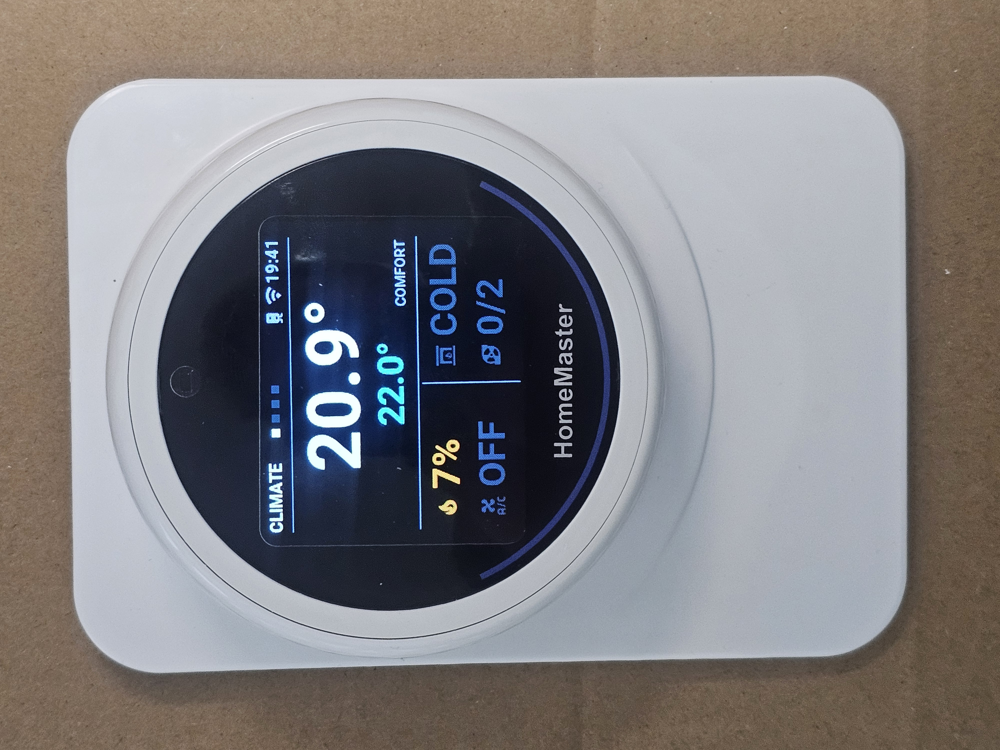

## HomeMaster OpenTherm Thermostat



## Description

The HomeMaster OpenTherm Thermostat is a wall-mounted ESP32 device that acts as an
**OpenTherm master** for modulating boilers. It carries a 2.8″ colour display, a
rotary encoder, four keys, a 24 GHz presence radar, and on-board temperature,
humidity and ambient light sensors.

The heating control loop runs on the device: weather-compensated flow temperature,
room setpoint with hysteresis, and a comfort/eco schedule. Home Assistant is used
for visibility and remote control, not as a dependency — the room keeps being
heated if the network is down.

This page includes the full ESPHome configuration used on shipped devices
(including vendor OTA update settings).

For complete product documentation (connections, compliance, wiring and
schematics), see:

- Product page: [home-master.eu](https://www.home-master.eu/)
- Repository: [GitHub repository](https://github.com/isystemsautomation/homemaster-dev/tree/main/OpenthermThermostat)
- Schematics (PDF):
  [Schematics/](https://github.com/isystemsautomation/homemaster-dev/tree/main/OpenthermThermostat/Schematics)
- Maker: [home-master.eu](https://www.home-master.eu/)

## Hardware Details

- **MCU:** ESP32-WROOM-32U (16 MB flash, external antenna connector)
- **Architecture:** Modular — MCU Board + Display Board
- **Part number:** OTT-R1
- **Manufacturer:** ISYSTEMS AUTOMATION S.R.L.
- **Enclosure:** Italtronic EYE BOX, wall mounted

## Power Input

| Method | Terminals | Range |
|---|---|---|
| 24 V DC | +V / 0V | 24 V DC nominal |

The device is low-voltage only. No mains terminals are present.

## Terminal Connections

| Terminal | Function |
|---|---|
| +V | 24 V DC supply |
| 0V | 0 V |
| OT+ | OpenTherm bus, boiler terminal 1 |
| OT− | OpenTherm bus, boiler terminal 2 |

The OpenTherm interface is polarity-insensitive.

## Peripherals

| Device | Interface | Address / pins |
|---|---|---|
| ST7789V display, 320 × 240 | SPI | CS 17, DC 19, RST 13, CLK 5, MOSI 23 |
| Backlight | LEDC PWM, 25 kHz | GPIO25 |
| SHT40 temperature / humidity | I²C | 0x44 |
| BH1750 ambient light | I²C | 0x23 |
| HLK-LD2410C presence radar | UART + GPIO | TX 14, RX 16, OUT 4 |
| Rotary encoder | GPIO | A 32, B 33 |
| Keys ▶ ▲ ▼ ◀ | GPIO | 34, 35, 36, 39 |
| OpenTherm | GPIO | IN 21, OUT 26 |

## GPIO Notes

### GPIO5 — display clock (strapping pin)

GPIO5 is a strapping pin on the ESP32. It is used here as the SPI clock for the
display and is driven only after boot. No external pull resistor is fitted.

### GPIO34 / 35 / 36 / 39 — keys

These are input-only pins with no internal pull resistors. Each key has an
external 10 kΩ pull-up to 3V3 and a 100 nF debounce capacitor on the board.

## Features

- ESP32 OpenTherm master — full boiler telemetry and modulating control
- Local control loop; no cloud and no Home Assistant dependency for heating
- 2.8″ IPS colour display, rotary encoder, four keys
- 24 GHz presence radar for screen wake and occupancy reporting
- On-board temperature, humidity and ambient light sensing
- ESPHome pre-installed
- Improv provisioning over BLE and USB serial
- OTA updates (ESPHome + HTTP)
- Wall mounting

## Electrical and Safety Notes

> ⚠️ Supplied from 24 V DC only. Do not connect mains voltage to any terminal.
> Disconnect power before wiring changes. Keep the OpenTherm pair out of mains
> cable bundles.

## Mechanical and Environmental

Enclosure: Italtronic EYE BOX, ABS, white (RAL 9003).

| Dimension | Value |
|---|---|
| Body outer diameter | Ø 94.6 mm |
| Front aperture | Ø 82.2 mm |
| Ring height | 20.5 mm |
| Wall base | Ø 88.7 mm, 10.5 mm deep, keyhole centres 58 mm |
| Wall plate (alternative) | 140 × 80 mm, 9 mm thick, cable aperture 45 × 30 mm |

- Indoor use, dry locations
- Operating temperature: 0 … 40 °C, non-condensing
- Two-part enclosure: wall base or plate fixed to the wall, body clipped on

## Getting Started

### Improv Wi-Fi Setup (Recommended)

1. Power the device.
2. Open [improv-wifi.com](https://improv-wifi.com) in Chrome or Edge.
3. Connect over Bluetooth, or over USB serial with a USB-C cable, and enter the
   Wi-Fi credentials.

### Taking control

Open ESPHome Device Builder and click **Take control**. This imports the
configuration and establishes your own API encryption key. Save that key before
adding the device in Home Assistant.

## Firmware Updates

### ESPHome updates (user-controlled)

Adopt the device in ESPHome Device Builder and build from the published
configuration.

### Managed updates (HTTP)

The shipped configuration carries an `update` entity backed by a vendor JSON
manifest. New releases appear under Settings → Updates in Home Assistant.

## ESPHome Compatibility

Requires ESPHome 2026.7.0 or newer, for the `mipi_spi` display platform and the
`opentherm` component.

## User Interface

Four keys and one encoder, identical on every page:

| Control | Action |
|---|---|
| ◀ ▶ | previous / next page |
| ▲ ▼ | open the menu, move through it |
| encoder | change the page's main value, or the selected menu item |
| ◀ with the menu open | close the menu |

Pages: CLIMATE (room, setpoint, boiler), BOILER (flow, return, DHW, faults),
SCHEDULE (comfort and eco windows), SYSTEM (network, sensors, diagnostics).

## Example Entities

| Entity | Type |
|---|---|
| Room Temperature | sensor |
| Room Humidity | sensor |
| Ambient Light | sensor |
| Comfort Temperature | number |
| Eco Temperature | number |
| Heating Target | sensor |
| Flow Setpoint By Curve | sensor |
| Boiler Water Temperature | sensor |
| Boiler Relative Modulation Level | sensor |
| Boiler CH Pressure | sensor |
| Outside Temperature | sensor |
| Boiler Flame On | binary_sensor |
| Boiler CH Enable | switch |
| Boiler DHW Enable | switch |
| Heating Automatic | switch |
| Boost Until Next Change | switch |
| Comfort Window | binary_sensor |
| Presence | binary_sensor |
| Radar Target | binary_sensor |
| Backlight | light |
| Firmware Update | update |

## Configuration

```yaml url=https://github.com/isystemsautomation/homemaster-dev/blob/main/OpenthermThermostat/Firmware/thermostat.yaml
```

## License

Hardware is licensed under CERN-OHL-W v2. Firmware and ESPHome configuration are
licensed under the MIT License.
